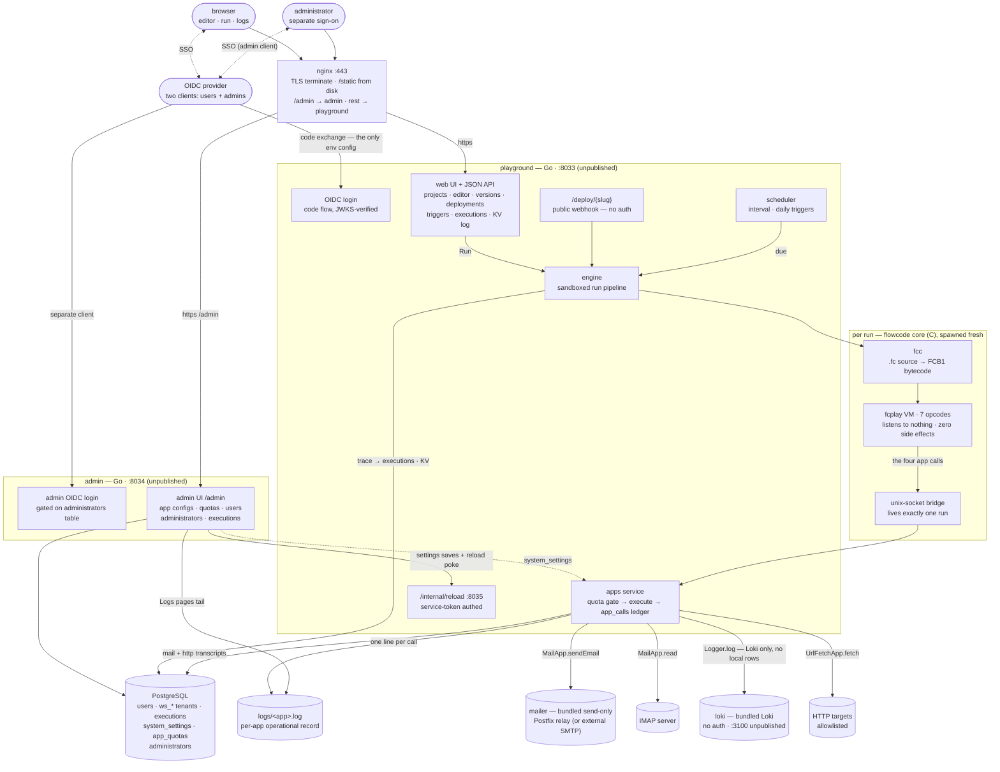

# FlowCode Playground

A Google-Apps-Script-style platform for
[FlowCode](https://github.com/tayyebi/flowcode): sign in with your
organization account, write a workflow in a saved project, press Run, and see
the compiler's diagnostics, the bytecode it emitted, a trace of the VM
executing it, and a transcript of every app call it made. Projects keep
versioned snapshots, deploy a file as a public HTTP endpoint (the webhook
trigger), schedule time-driven triggers, and can call the built-in apps —
**MailApp**, **UrlFetchApp**, and **Logger** — whose credentials your system
administrators configure, not the environment.

```
docker compose up -d
```

Then open <https://localhost> (a self-signed certificate is generated on
first boot — see below) and sign in with SSO. The administration area is a
separate service with its own login at <https://localhost/admin>.

## Architecture



Every third party is an integration, never a hosted feature: login (OIDC),
mail (the bundled send-only relay), logs (the bundled Loki), outbound HTTP
(allowlist). Six services share one private compose network:
**nginx** (the only published ports, TLS terminator, serves `/static/`
straight from the repo so the Go binaries ship no static files), the
**playground** (user area), **admin** (the administration area — its own
OIDC client and login, its own `administrators` table; platform admins have
no user-side powers), **PostgreSQL** (passwordless trust auth, port never
published), the **mailer** (a private send-only Postfix relay — the Mail
app's bundled external backend; port 25 never published, no credentials in
or out), and **loki** (the Logger app's bundled backend — no authentication,
port 3100 never published; the app is hard-wired to it). The playground owns every runtime
socket — HTTP for users, the public deploy URLs as the webhook listener, a
per-run unix bridge for app calls; the core is pure compute with zero side
effects. The detailed, numbered-flow version lives in
[`docs/architecture.md`](docs/architecture.md).

### Logging: three destinations, three owners

- **Platform services log to their own stdout/stderr** (`docker compose
  logs`), never to Loki and never to the app files.
- **Each app keeps its own operational log file** — `data/logs/mail.log`,
  `data/logs/http.log`, `data/logs/logger.log`, one JSON line per dispatched bridge
  call (successes, failures, quota rejections alike). The administration
  area's Logs pages tail these files. Logger entries carry the outcome and
  labels only; a user's log line never lands in a platform file.
- **User `Logger.log` entries go to Loki only** — Loki is the Logger app's
  external backend and is never read by the platform.

## The user journey (the Apps Script mapping)

| Google Apps Script | FlowCode Playground |
|---|---|
| Google account sign-in | OIDC single sign-on (any discovery-based provider) |
| script.google.com home / My Projects | `/projects` — your personal workspace's projects |
| Editor + Run + execution log | project page: editor, Run, Trace / Bytecode / Diagnostics / **App calls** |
| `MailApp.sendEmail()` | `MailApp.sendEmail` (SMTP, admin-configured) |
| `UrlFetchApp.fetch()` | `UrlFetchApp.fetch` (HTTP, admin-configured allowlist) |
| `Logger.log()` | `Logger.log` (pushed to the bundled Loki) |
| Web-app deployment / webhooks | public `/deploy/{slug}` URLs — **the playground listens, the core never does** |
| Time-driven triggers | interval / daily-at-UTC triggers per project file |
| Admin console | `/admin` — a separate service and login: per-app Configuration, Logs, Rate limits, Users, Executions, Administrators, General |

## The three apps

Workflow source reads exactly like Apps Script — call parameters compile
into the bytecode and cross the plugin ABI:

```
workflow: OrderPipeline

step notify:
    MailApp.sendEmail
        to = "alice@example.com"
        subject = "Order shipped"
        body = "It is on the way."
end

step fetchTracking:
    UrlFetchApp.fetch
        url = "https://carrier.example.com/track/123"
        Accept = "application/json"
end

step logged:
    Logger.log
        message = "notification sent"
end
```

- **MailApp.sendEmail** — hands the message to the bundled private
  send-only relay (hard-wired `mailer:25`, no credentials; only the toggle
  and the sender address are admin-configured in `/admin/mail`). Params
  `to`/`subject`/`body` are optional with the current token as fallback.
- **MailApp.read** — not supported: the bundled relay is send-only, and the
  call fails loudly (strict semantics).
- **UrlFetchApp.fetch** — outbound HTTP (`url`, `method`, `body`; every
  other param is a request header). The response body becomes the token,
  capped by the admin-configured size limit.
- **Logger.log** — one log entry pushed to the bundled Loki (hard-wired
  `http://loki:3100`, no authentication). Nothing is stored locally: the
  fresh-run transcript is in-memory, history lives in Loki; only the push's
  outcome (not the message) reaches the app's own operational log.

All four are **strict**: a disabled app, missing credentials, an exhausted
per-user rate limit, or an unreachable backend halts the workflow with a
clear trace line. A logger that silently drops entries is worse than one
that fails loudly.

## Configuration: env is for booting, /admin is for running

The **only application configuration in the environment** is the OIDC
credentials (two clients: one for users, one for the administration area) —
the servers need them before they can authenticate anything — plus the
mailer's sending hostname. Everything else lives in PostgreSQL
(`system_settings`, seeded with defaults by the migrations) and is managed
by administrators in the `/admin` area.

| Env var | Purpose |
|---|---|
| `OIDC_ISSUER` | Provider issuer URL (discovery-based, any provider) — **required** |
| `OIDC_CLIENT_ID` / `OIDC_CLIENT_SECRET` | User-area OAuth2 client — **required** |
| `OIDC_REDIRECT_URL` | Defaults to `https://<request-host>/api/auth/callback` |
| `OIDC_ADMIN_CLIENT_ID` / `OIDC_ADMIN_CLIENT_SECRET` | The administration area's **separate** OAuth2 client — **required** |
| `OIDC_ADMIN_REDIRECT_URL` | Defaults to `https://<request-host>/admin/api/auth/callback` |
| `MAIL_NAME` | The bundled mailer's sending hostname — **required**; must match the host's PTR record and the domain's SPF |
| `MYNETWORKS` | Who may hand the bundled mailer mail (default: loopback + RFC1918) |
| `ADMIN_EMAILS` | Comma-separated allowlist seeded into `administrators` on the admin service's first boot (only while the table is empty) |
| `DATABASE_URL` | PostgreSQL DSN — passwordless inside the compose network |
| `APP_INTERNAL_URL` | The playground's unpublished `/internal` listener (admin → app reload pokes) |
| `APP_LOG_DIR` | Where the per-app operational log files live (default `data/logs/`) |
| `PORT`, `PLAYGROUND_WORKDIR`, `FLOWCODE_FCC`, `FLOWCODE_RUNNER` | Boot paths (sane defaults in the container) |
| `TRUST_PROXY` | `1` when a proxy you control (nginx) fronts the services |
| `FLOWCODE_REPO` / `FLOWCODE_REF` | Compose build pins |
| `HTTPS_PORT` / `HTTP_PORT` | Host port mapping for nginx (default 443/80) |
| `CERT_CN` / `CERT_DNS` / `CERT_IP` | Subject/SANs for the first-boot self-signed certificate |

Admin-managed (`/admin`, stored in PostgreSQL): the mail and logger enable
toggles (their backends are hard-wired compose services) and the mail sender
address, the UrlFetchApp allowlist and caps, per-app default and per-user
rate limits, and sandbox limits (timeout, concurrency, site rate limits — applied when the
playground restarts). Settings saves are picked up by the playground
immediately via the internal reload poke (with a once-a-minute fallback
refresh).

### The administration area

The admin area is deliberately a **separate service with a separate
login**. Its `administrators` table is the allowlist — platform users and
platform admins sit in different tables, and an admin identity has no
user-side powers (and vice versa). Bootstrap on first boot:

```sh
MAIL_NAME=mail.example.com ADMIN_EMAILS=you@example.com docker compose up -d
```

Afterwards, manage the allowlist in `/admin/administrators` (add by email;
removing a row also kills that admin's session; the last admin and you
yourself cannot be removed). A `__service_token` (internal setting,
rotatable in /admin → General) lets scripts call the JSON API with
`Authorization: Bearer`.

### TLS certificates

On first boot the nginx entrypoint generates a self-signed certificate into
`data/certs/` (git-ignored, persistent between runs) — expect a browser
warning. To use a real certificate, overwrite `data/certs/fullchain.pem`
and `data/certs/privkey.pem` and restart the nginx service; nginx loads
whatever is there. No restart loop, no renewal sidecar: certificate renewal is your
(`certbot`/ACME) job.

## Mail and Loki (both bundled, both hard-wired)

`MailApp.sendEmail` is backed by the **bundled `mailer` service** — a
private, no-auth, send-only Postfix relay on the compose network (port 25
never published; postgres is the model). It delivers straight to recipient
MX servers: no smarthost, no credentials anywhere. `Logger.log` is backed
by the **bundled `loki` service** the same way — no authentication, port
3100 never published, the app hard-wired to it. The docker network is the
only protection both of them need or have.

For the relay's mail to actually land in inboxes, three things must be true
on the hosting side (the DNS checklist; DKIM signing is deliberately
deferred — big providers may spam-bin until it is added):

1. outbound port 25 is open on the host (many providers block it by
   default),
2. the host's PTR/rDNS record equals `MAIL_NAME`,
3. the sending domain's SPF TXT record authorizes the host's IP.

Loki keeps Logger.log entries for 14 days
(`containers/loki/loki-config.yml`). The
admin Logs pages never read Loki — they tail each app's own log file
(`data/logs/<app>.log`); user log entries are queryable only through Loki's own
API.

## Security model

- **The core listens to nothing.** `fcc` and `fcplay` are pure compute; the
  playground web server owns every socket: HTTP for users, a per-run unix
  socket for app calls, public deploy URLs as the webhook listener.
- **One published surface.** Only nginx's 443/80 are published. PostgreSQL
  (passwordless `trust`), the bundled mailer's port 25 (no auth — safe only
  because it is unreachable from outside), and every service-to-service
  port (:8033, :8034, the internal :8035 reload API) live on the private
  compose network.
- **Separation of admins from users.** The admin area authenticates against
  its own OIDC client and the `administrators` allowlist; there is no
  admin flag on users, and admins hold no powers over user projects.
- Runs execute in a sandboxed subprocess: bare environment, own process
  group, wall-clock timeout, rlimits (CPU, address space, file size,
  nproc), capped output.
- OIDC ID tokens are verified against the provider's JWKS; sessions are
  HMAC-signed cookies with database-stored secrets (one per area).
- Every page and API route requires a signed-in user; project access goes
  through workspace membership (`EffectiveProjectRole` — viewers are
  read-only). Foreign project ids return 404, not 403.
- Public `/deploy/{slug}` traffic is rate-limited and attributed to the
  project's owner for quotas and app-call records.
- No app credentials exist anywhere: the mail and Loki backends are
  hard-wired compose services protected by the docker network, so the admin
  UI holds no connection settings to leak (only toggles, the mail sender
  address, quotas, and limits).

## Projects, deployments, triggers, and the KV log

A project is a set of independently runnable `.fc` files. Versions snapshot
all files; restoring one rewrites them. A deployment publishes one file at a
public URL — any request runs the workflow (the request itself is ignored;
the URL is the webhook trigger). Triggers run a file on an interval or daily
at a UTC time. The KV log is a write-side record of what `store set` calls
left behind — it is not a readable key-value API for scripts.

## Development

```
cd server && go vet ./... && go test ./...   # unit + store + scheduler + engine tests
make -C ../flowcode test                     # core language tests
```

The store and scheduler tests run against a real PostgreSQL and skip with a
pointer to these two lines when it is absent:

```
docker run -d --rm --name pg-test -p 55432:5432 -e POSTGRES_HOST_AUTH_METHOD=trust postgres:17-alpine
TEST_DATABASE_URL='postgres://postgres@localhost:55432/postgres?sslmode=disable' go test ./...
```

Both binaries embed their templates (`server/web/templates/`,
`server/cmd/admin/templates/`); there is no frontend build. Static assets
live in the repo's `static/` directory and are served by nginx — the single
source of truth. `fcc` and `fcplay` are located via `FLOWCODE_FCC` /
`FLOWCODE_RUNNER`. Architecture diagram:
[`docs/architecture.md`](docs/architecture.md).
